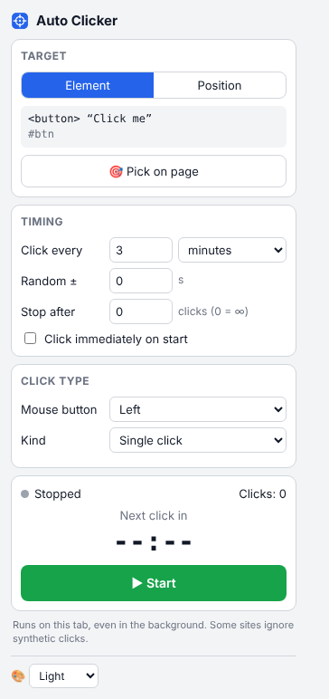

# Auto Clicker

A simple, free auto clicker for **Windows**, **macOS** and **Linux**.
Pick a spot on your screen, choose how often to click, press Start — Auto Clicker does the rest.
It also comes with a **Chrome / Edge extension** that clicks a button inside a web page, even when the tab is in the background.

<p align="center">
  
  
  
</p>

## Features

- **Point and click setup** — the screen dims and shows a crosshair with live X/Y coordinates; just click where you want the auto clicks to land. Works with multiple monitors.
- **Flexible timing** — click every few seconds, minutes or hours, add a little randomness, and stop automatically after a number of clicks.
- **Schedule** — start at a time of day (19:30) or after a countdown (00:20:00), and stop at a time of day (21:00) or after running for a while (01:30:00).
- **Any click** — left, right or middle button, single or double click.
- **Stays out of your way** — puts the cursor back where it was after each click, keeps the computer from sleeping, and keeps running from the system tray when you close the window.
- **Emergency stop** — move the mouse to the top-left corner of the screen, or press `Ctrl+Enter` (`⌘↩` on Mac).
- **Light, dark or system theme.**
- **Remembers your settings** for next time.

## Download

Get the latest version from the **[Releases page](https://github.com/khaid2849/auto_clicker/releases)**:

| System | File | How to open |
|---|---|---|
| Windows 10 / 11 | `AutoClicker-windows-x64.zip` | Unzip and run `AutoClicker.exe`. If Windows SmartScreen appears, click **More info → Run anyway**. |
| macOS (Apple Silicon) | `AutoClicker-macos-arm64.zip` | Unzip and drag `AutoClicker.app` to **Applications**. The first time, right-click the app and choose **Open**. |
| Linux | `AutoClicker-linux-x64.tar.gz` | Extract it and run `AutoClicker/AutoClicker`. See [Linux notes](#linux). |
| Android 7.0+ | `AutoClicker-android.apk` | Open the file on your phone and allow installing from this source. See [Android](#android-app). |

## How to use

1. Click **🎯 Pick position on screen**, then click the spot you want to auto-click. Press **Show point** to double-check it.
2. Set **Click every** (3 minutes by default) and any other options you like.
3. Press **▶ Start**. The big timer counts down to the next click.
4. Press **■ Stop** when you're done, or use the emergency stop.

**Start or stop at a set time.** In **Schedule**, choose when to start: **Right away**, **At (time of day)** such as 19:30, or **After a countdown** such as 00:20:00. Then choose when to stop: **No time limit**, **At (time of day)** such as 21:00, or **After running for** such as 01:30:00. Press **▶ Start**: the status shows *Waiting to start* and counts down to the start time. Press **■ Stop** to cancel at any time.

- A time of day that has already passed today means tomorrow. The stop time counts from the start, so *start 22:00, stop 01:00* runs overnight.
- *After running for* counts from when the clicks begin, not from when you pressed Start.
- **Stop after** (number of clicks) still works too: whichever comes first ends the run.
- Leave **Keep the computer awake** on, so the computer isn't asleep when the start time comes.

You can close the window while it's running — Auto Clicker keeps going in the background. Reopen it from its icon in the system tray (menu bar on Mac).

## Android app

1. Open Auto Clicker and press **Turn on**, then turn on **Auto Clicker** in **Settings → Accessibility** (under *Installed apps* or *Downloaded apps*). Android only lets an app tap for you this way. The app doesn't read your screen.
2. Set the timing and press **Show floating controls**.
3. Open the app you want to tap on. On the floating panel, press **🎯** and touch the spot, then press **▶**. Press **■** to stop.

The **Schedule** settings work as on the desktop: start at 19:30 or after 00:20:00, stop at 21:00 or after 01:30:00. While it waits, the panel shows *Starts in* and the time left. Keep **Keep the screen on** checked: Android can pause the app while the screen is off.

The app isn't on Google Play. Building it yourself: see [`android/README.md`](android/README.md). There's no iOS version, because iOS doesn't let apps tap on other apps.

## Browser extension (Chrome & Edge)

The extension clicks a button — or a fixed spot — **inside a web page** on a schedule. It works in Chrome, Edge and other Chromium browsers such as Brave, Opera and Vivaldi, and doesn't need the desktop app to run.

**Install it**

1. In the desktop app, click **🧩 Browser extension → Create and open folder**. This puts the extension in `Documents/AutoClicker Extension`.
   *Not using the desktop app?* Download this repository (**Code → Download ZIP**), unzip it and use the folder `src/autoclicker/browser_extension`.
2. Open `chrome://extensions` (in Edge: `edge://extensions`) and turn on **Developer mode**.
3. Click **Load unpacked** and choose the folder from step 1.
4. Pin **Auto Clicker** to your toolbar from the puzzle-piece 🧩 menu.

Keep the folder where it is — the browser loads the extension from it.

**Use it**

1. Open the page you want to click on and click the Auto Clicker icon.
2. Click **🎯 Pick on page**, then click the button you want to auto-click.
3. Open the Auto Clicker icon again, set the timing and press **▶ Start**.

**Schedule** works here as well: start at a time of day or after a countdown, and stop at a time of day or after running for a while. While it waits, the icon shows **WAIT**.

The icon shows how many clicks have been made. Your pick is remembered for each website. The first time you start on a site, the browser asks for permission to access it — allow it so clicking continues after the page reloads.

## Good to know

### macOS
macOS only lets apps click for you after you allow it. The first time you press Start, Auto Clicker shows a message with an **Open Settings** button: go to **System Settings → Privacy & Security → Accessibility** and turn on **AutoClicker**.

### Windows
Windows doesn't let normal apps click inside programs that run as Administrator. If you need that, right-click Auto Clicker and choose **Run as administrator**.

### Linux
- On Ubuntu you may need one extra package: `sudo apt install libxcb-cursor0`
- Ubuntu 22.04 and newer use **Wayland** by default, which needs a one-time permission. Open a terminal and run:

  ```bash
  curl -fsSLO https://raw.githubusercontent.com/khaid2849/auto_clicker/main/scripts/setup_uinput.sh
  bash setup_uinput.sh
  ```

  Then log out and log back in.
- On Wayland the app can't see where your mouse is, so *Move the cursor back* and the corner emergency stop are not available. If you need them, or clicks land in the wrong place on multiple monitors, choose **Ubuntu on Xorg** from the ⚙️ menu on the login screen.

## Troubleshooting

**Nothing gets clicked.**
Check the yellow warning at the top of the window — it tells you which permission is missing. On macOS that's Accessibility, on Linux/Wayland it's the one-time setup above.

**The click lands in the wrong place.**
Pick the position again with **🎯 Pick position on screen** instead of typing coordinates, then use **Show point** to check.

**The computer went to sleep and clicking stopped.**
Make sure **Keep the computer awake while running** is ticked.

**The extension shows "Target not found".**
The page changed and the button is gone or was renamed. Pick it again, or switch the target to **Position**.

**A website ignores the extension's clicks.**
A few sites only accept clicks from a real mouse. Use the desktop app for those.

**The extension stops in Edge after a while.**
Edge may put background tabs to sleep. Add the site to *Never put these sites to sleep* in **Settings → System and performance**.
