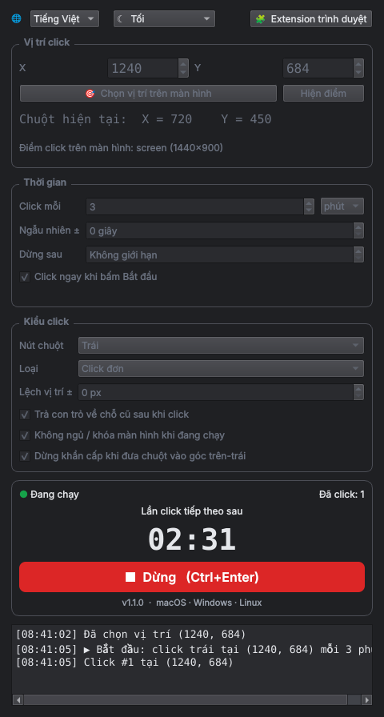

# Auto Clicker

Tự động click chuột tại một vị trí cố định theo chu kỳ (mặc định 3 phút/lần), có giao diện đồ họa.
Một mã nguồn duy nhất chạy trên **macOS**, **Windows** và **Linux** (Ubuntu X11 lẫn Wayland), kèm **extension cho Chrome / Edge** để auto click bên trong trang web.

<p align="center">
  
  
  
</p>

## Tính năng

- **Chọn vị trí trực quan**: màn hình phủ mờ với tâm ngắm và tọa độ X/Y chạy theo chuột, click để chọn. Hỗ trợ nhiều màn hình.
- **Hiện điểm**: nháy vòng tròn đỏ đúng chỗ sẽ click để kiểm tra.
- **Tùy chỉnh**: chu kỳ theo giây/phút/giờ, cộng trừ ngẫu nhiên, dừng sau N lần, nút trái/phải/giữa, click đơn/đôi, lệch vị trí ngẫu nhiên.
- **Chạy nền an toàn**: trả con trỏ về chỗ cũ, chống ngủ/khóa màn hình, dừng khẩn cấp khi đưa chuột vào góc trên-trái, điều khiển từ icon khay hệ thống, phím tắt `Ctrl+Enter` (`⌘↩` trên Mac).
- **Ngôn ngữ Tiếng Việt / English** và **giao diện Sáng / Tối / Theo hệ thống**: đổi ngay ở thanh trên cùng, kể cả khi đang chạy.
- **Extension Chrome / Edge**: nút *Extension trình duyệt* trong app hướng dẫn cài từng bước.
- **Tự lưu cài đặt** cho lần mở sau.

## Cài đặt

### Cách 1: tải bản dựng sẵn (không cần Python)

Vào trang [Releases](https://github.com/khaid2849/auto_clicker/releases), tải file đúng hệ điều hành:

| Hệ điều hành | File | Cách mở |
|---|---|---|
| Windows | `AutoClicker-windows-x64.zip` | Giải nén, chạy `AutoClicker.exe`. Nếu SmartScreen chặn: **More info → Run anyway** |
| macOS (Apple Silicon) | `AutoClicker-macos-arm64.zip` | Giải nén, kéo `AutoClicker.app` vào Applications. Lần đầu: chuột phải → **Open** (app chưa ký) |
| Linux | `AutoClicker-linux-x64.tar.gz` | `tar xzf AutoClicker-linux-x64.tar.gz && ./AutoClicker/AutoClicker` |

### Cách 2: chạy từ mã nguồn (giống nhau cho mọi hệ điều hành)

Cần Python 3.9 trở lên.

```bash
git clone https://github.com/khaid2849/auto_clicker.git
cd auto_clicker
python3 -m venv .venv
source .venv/bin/activate        # Windows: .venv\Scripts\activate
pip install .
autoclicker                      # hoặc: python -m autoclicker
```

`pip` tự cài đúng thư viện cho hệ điều hành của bạn (pyobjc trên macOS, python-xlib và jeepney trên Linux; Windows chỉ cần PySide6).

**Ubuntu**: thay vì các bước trên, chạy một lệnh để có sẵn icon trong menu ứng dụng và tự cấu hình Wayland:

```bash
./scripts/install_linux.sh       # gỡ: ./scripts/uninstall_linux.sh
```

### Cách 3: tự đóng gói thành app

```bash
pip install ".[build]"
python scripts/build.py
```

Kết quả trong `dist/`: `AutoClicker.app` trên macOS, `AutoClicker.exe` (một file duy nhất) trên Windows, thư mục `AutoClicker/` trên Linux. Muốn có app cho hệ điều hành nào thì chạy lệnh trên chính hệ điều hành đó.

## Extension cho Chrome / Edge

Extension tự click vào **một nút trong trang web** (chọn bằng chuột, lưu dạng CSS selector) hoặc **một vị trí trong khung nhìn**, theo chu kỳ, kể cả khi tab đang ở nền. Dùng được cho Chrome, Edge và các trình duyệt nhân Chromium (Brave, Cốc Cốc, Opera). Extension chạy độc lập, không cần mở app desktop.

**Cài đặt** (Chrome/Edge chỉ cho cài extension ngoài store qua chế độ Developer):

1. Trong app desktop, bấm **🧩 Extension trình duyệt → Tạo và mở thư mục**. App chép extension vào `Documents/AutoClicker Extension`.
   Không dùng app? Lấy thẳng thư mục [`src/autoclicker/browser_extension`](src/autoclicker/browser_extension) trong repo.
2. Mở `chrome://extensions` (Edge: `edge://extensions`), bật **Developer mode**.
3. Bấm **Load unpacked** và chọn thư mục ở bước 1.
4. Ghim icon Auto Clicker lên thanh công cụ.

**Sử dụng**: mở trang cần click → bấm icon Auto Clicker → **Chọn trên trang** → click vào nút cần auto click → mở lại icon → **Bắt đầu**. Số lần đã click hiện trên icon. Mục tiêu được nhớ theo từng trang web.

Lưu ý:
- Lần đầu bấm Bắt đầu trên một trang, trình duyệt hỏi quyền truy cập trang đó. Cấp quyền thì extension vẫn click tiếp sau khi trang tải lại.
- Click do extension tạo là click giả lập (`isTrusted = false`). Phần lớn trang web nhận bình thường, nhưng một số trang cố tình bỏ qua loại click này; khi đó hãy dùng app desktop.
- Không click được vào nội dung nằm trong `iframe` khác tên miền, và không chạy trên trang hệ thống (`chrome://…`) hay cửa hàng tiện ích.
- Edge có tính năng *Sleeping tabs* có thể cho tab ngủ: hãy thêm trang vào danh sách không bao giờ ngủ (*Settings → System and performance*).
- Cập nhật extension: bấm lại bước 1 trong app rồi bấm nút tải lại ↻ trên thẻ extension.

## Lưu ý theo hệ điều hành

### macOS
macOS chỉ cho gửi click khi app có quyền **Accessibility**. Lần đầu bấm Bắt đầu, app sẽ hiện cảnh báo kèm nút **Mở cài đặt**: vào *System Settings → Privacy & Security → Accessibility* và bật **AutoClicker**. Nếu chạy từ Terminal thì bật cho **Terminal**.
Mỗi lần build lại `.app`, chữ ký thay đổi, nên phải xóa mục cũ trong danh sách Accessibility rồi thêm lại.

### Windows
Windows không cho app thường click vào cửa sổ đang chạy bằng quyền Administrator. Nếu cần click vào app như vậy, hãy chạy Auto Clicker bằng **Run as administrator**.

### Linux
| | X11 (Ubuntu on Xorg) | Wayland (mặc định từ Ubuntu 22.04) |
|---|---|---|
| Cách gửi click | XTest | Chuột ảo qua `/dev/uinput` |
| Cần cấu hình thêm | Không | `./scripts/setup_uinput.sh`, rồi đăng xuất và đăng nhập lại |
| Xem vị trí chuột trực tiếp / trả con trỏ về chỗ cũ / dừng khẩn cấp | Có | Không (Wayland không cho app đọc vị trí chuột) |

- Qt cần gói `libxcb-cursor0`: `sudo apt install libxcb-cursor0` (`install_linux.sh` đã tự cài).
- Trên Wayland nếu dùng nhiều màn hình mà click bị lệch, hãy chuyển sang phiên **Ubuntu on Xorg** ở màn hình đăng nhập (biểu tượng ⚙️).

## Cấu trúc dự án

```
src/autoclicker/
├── __main__.py            # điểm vào: lệnh `autoclicker` / `python -m autoclicker`
├── app.py                 # cửa sổ chính (dùng chung mọi hệ điều hành)
├── overlays.py            # màn hình chọn vị trí, vòng tròn đánh dấu
├── i18n.py                # chuỗi Tiếng Việt / English
├── theme.py               # giao diện Sáng / Tối / Theo hệ thống
├── extension_installer.py # hộp thoại cài extension trình duyệt
├── common.py              # hằng số, icon, tiện ích
├── backends/              # phần duy nhất khác nhau giữa các hệ điều hành
│   ├── __init__.py        # tự nhận diện hệ điều hành / phiên → chọn backend
│   ├── base.py            # interface chung: move(), click(), status()...
│   ├── macos.py           # Quartz CGEvent + chống App Nap
│   ├── windows.py         # SetCursorPos + SendInput (ctypes)
│   ├── x11.py             # XTest
│   ├── wayland.py         # chuột ảo /dev/uinput
│   └── linux_session.py   # chống khóa màn hình qua D-Bus
└── browser_extension/     # extension Chrome/Edge (Manifest V3)
    ├── manifest.json
    ├── background.js      # lịch click từng tab (chrome.alarms + setTimeout)
    ├── inject.js          # hàm click + chế độ chọn phần tử, chèn vào trang
    ├── popup.html/css/js  # giao diện popup
    └── i18n.js            # chuỗi Tiếng Việt / English
scripts/                   # build.py (PyInstaller), cài đặt Linux, cấu hình uinput
tests/                     # pytest; tests/extension/e2e.mjs: test extension trên Chrome thật
```

- Thêm hệ điều hành hoặc cách click mới: viết một lớp kế thừa `backends.base.Backend` rồi đăng ký trong `backends/__init__.py`.
- Thêm ngôn ngữ: thêm một khối chuỗi vào `i18n.py` (app) và `browser_extension/i18n.js` (extension). Test sẽ báo nếu thiếu khóa.

## Phát triển

```bash
pip install -e ".[dev]"
pytest
AUTOCLICKER_BACKEND=dry autoclicker   # chạy giao diện ở chế độ mô phỏng, không click thật
```

Biến môi trường `AUTOCLICKER_BACKEND` (`macos` | `windows` | `x11` | `wayland` | `dry`) dùng để ép chọn backend.

Test extension trên Chrome thật (cần Node.js và [Chrome for Testing](https://googlechromelabs.github.io/chrome-for-testing/) hoặc Chromium, vì Chrome bản thường từ v137 không còn nạp extension qua dòng lệnh):

```bash
npm install --no-save puppeteer-core
CHROME_PATH=/duong/dan/chrome node tests/extension/e2e.mjs
```

Khi đổi phiên bản, sửa cả `src/autoclicker/__init__.py` và `browser_extension/manifest.json` (có test kiểm tra hai số này khớp nhau).

**Phát hành**: push một tag dạng `v*` để GitHub Actions chạy test, đóng gói app cho cả 3 hệ điều hành và tạo Release:

```bash
git tag v1.1.0 && git push origin v1.1.0
```
